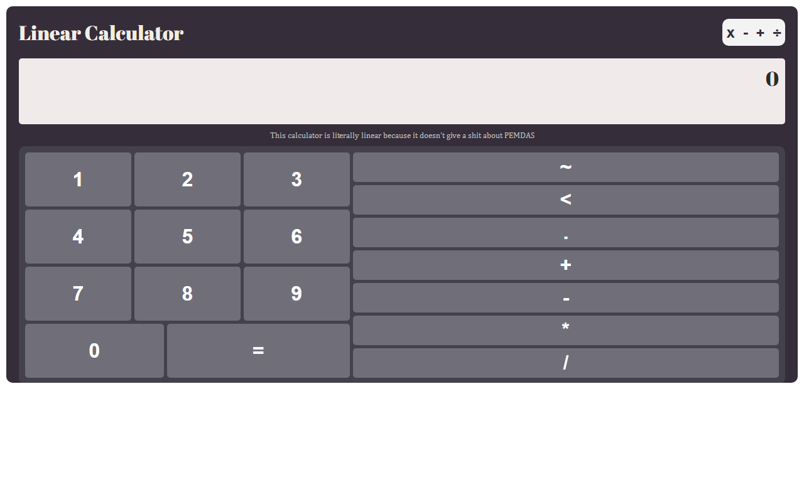

# Linear Calculator

A calculator that ignores PEMDAS: it works through the operations strictly from left to right.

**[Try it live](https://linearcalculator.vercel.app)**

For example, `2 + 3 × 4` gives **20** here, where a normal calculator gives 14.

## Run locally

Open `index.html` in a browser. There's no build step.

Negative numbers aren't supported yet.

## Built with

JavaScript, HTML and CSS.

## License

[MIT](LICENSE)
